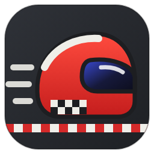
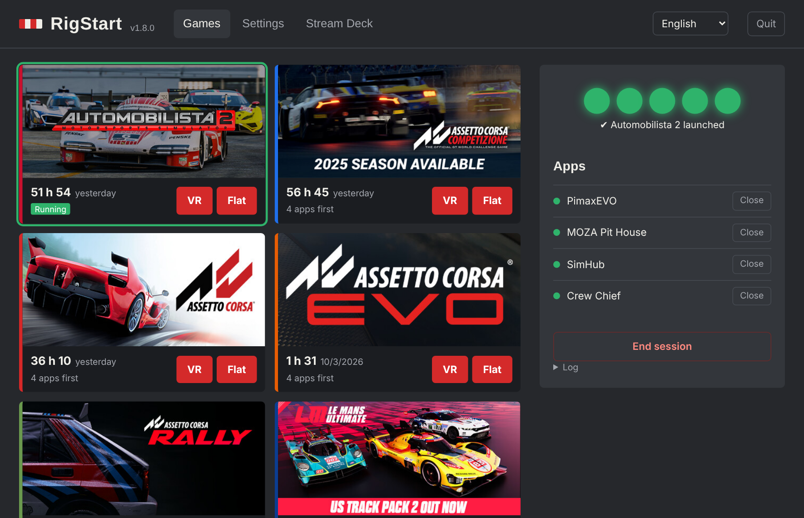
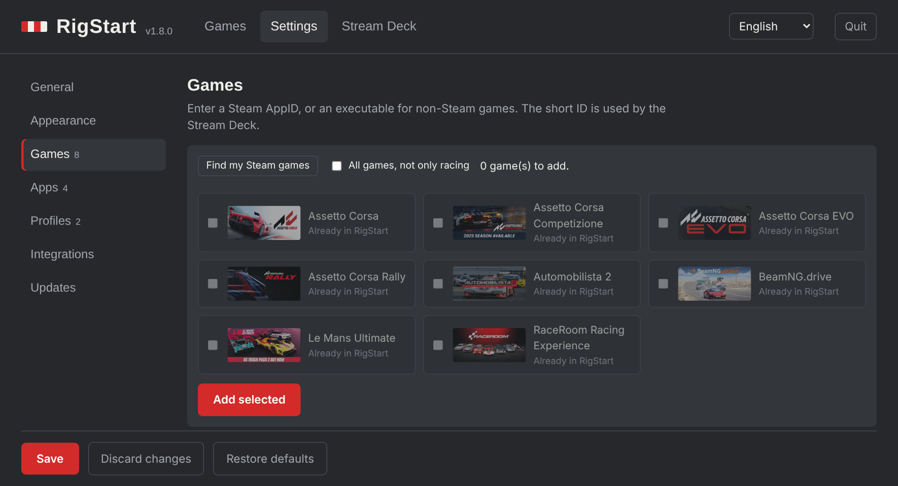
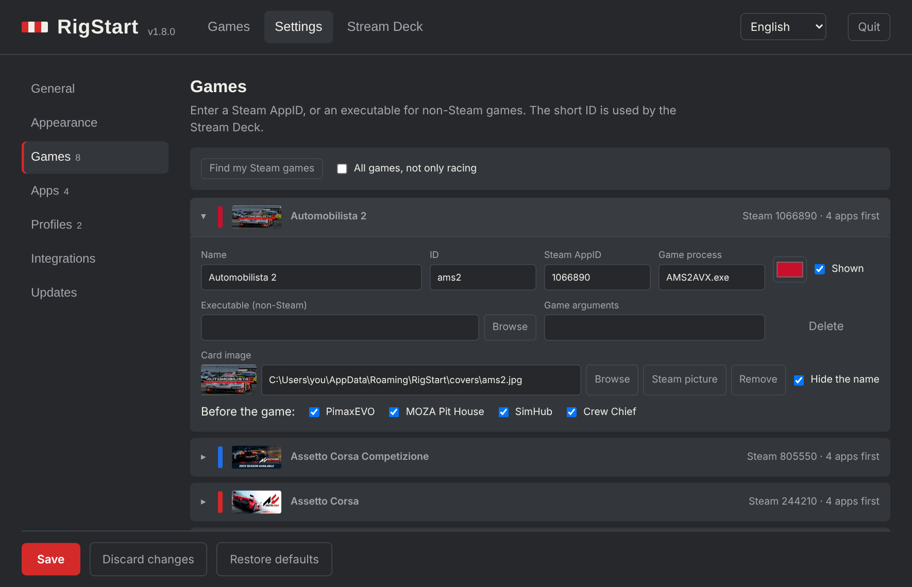
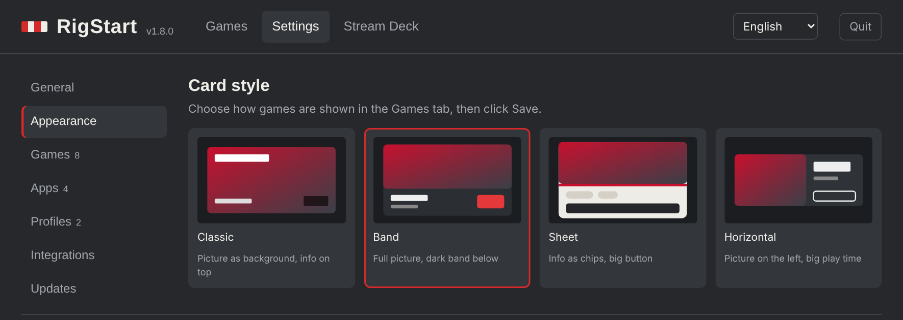
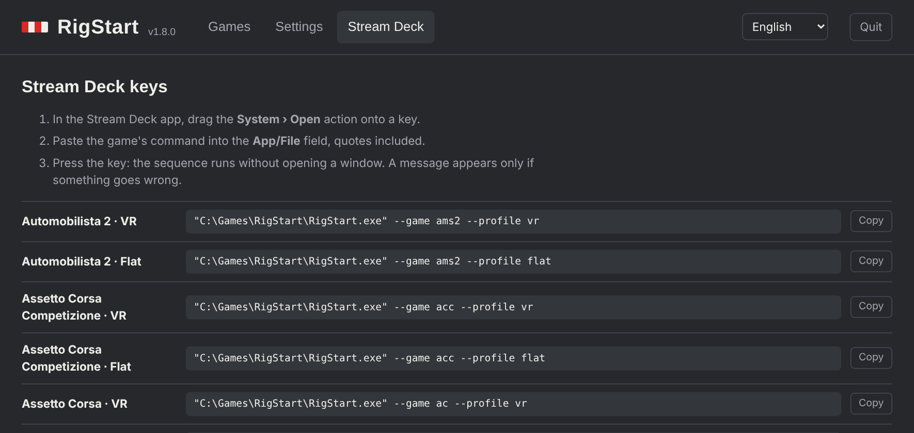

<p align="center"></p>

# RigStart

**Un clic, ou une touche de Stream Deck, pour démarrer toute une session de sim racing sous Windows.**

Une session de sim racing en VR, c'est souvent quatre ou cinq logiciels à ouvrir dans le bon ordre avant le jeu : le runtime VR, le logiciel du volant, SimHub, un spotter comme Crew Chief… RigStart démarre chacun s'il ne tourne pas déjà, attend qu'il soit prêt, puis lance le jeu. À la fin, un clic de plus ferme tout.

*Anciennement SimLauncher : le projet s'appelle RigStart depuis la version 1.8.0, pour ne plus être confondu avec une autre application open source du même nom.*

[English](README.md) · [Télécharger la dernière version](../../releases/latest)



## Sommaire

- [Fonctionnalités](#fonctionnalités)
- [Captures d'écran](#captures-décran)
- [Installation](#installation)
- [Prise en main](#prise-en-main)
- [Réglages](#réglages)
- [Stream Deck](#stream-deck)
- [Home Assistant et webhooks](#home-assistant-et-webhooks)
- [Assistants IA (MCP)](#assistants-ia-mcp)
- [Ligne de commande](#ligne-de-commande)
- [Mises à jour](#mises-à-jour)
- [Fichiers et vie privée](#fichiers-et-vie-privée)
- [Dépannage](#dépannage)
- [Compiler depuis les sources](#compiler-depuis-les-sources)
- [Historique des versions](#historique-des-versions)

## Fonctionnalités

**Lancement**
- **Une séquence par jeu** : les logiciels à démarrer avant chaque jeu, leur ordre et une pause après chacun.
- **Déjà ouvert ? Ignoré.** Rien n'est lancé deux fois.
- **Profils de séquence** : par exemple *VR* (le casque et tout le reste) et *Écran* (sans casque). Chaque carte affiche un bouton par profil, et chaque profil a sa propre commande Stream Deck.
- **Feux de départ** : cinq feux suivent la séquence et passent au vert quand le jeu est lancé.
- **Fin de session** : un bouton, une touche Stream Deck ou le menu de l'icône ferme le jeu et tous les logiciels.
- **Fermeture automatique (option)** : quand le jeu se termine, RigStart ferme les logiciels cochés (Crew Chief, par exemple).

**Ta bibliothèque**
- **Détection des jeux Steam** : retrouve les jeux de course installés dans Steam et ajoute ceux que tu coches, avec leur image Steam, leur processus et les logiciels compagnons.
- **Temps de jeu** : heures jouées et dernière session sur chaque carte. Les jeux Steam affichent tout l'historique enregistré par Steam ; les autres sont chronométrés par RigStart tant qu'il tourne.
- **Styles de cartes** : quatre présentations de l'onglet Jeux (Classique, Bandeau, Fiche, Horizontale), au choix dans *Réglages › Apparence*.
- **Images des jeux** : la bannière Steam ou n'importe quelle image .jpg, .png ou .webp en fond de carte, avec l'option de masquer le nom quand l'image contient déjà le logo.

**Intégrations**
- **Stream Deck** : une commande prête à coller pour chaque jeu et pour la fin de session. Des icônes originales sont fournies.
- **Home Assistant et webhooks** : une requête POST au début et à la fin de chaque session, pour allumer le cockpit ou lancer une scène.
- **Assistants IA (MCP)** : Claude Desktop et d'autres assistants peuvent lancer un jeu, terminer la session, ajouter des jeux et des logiciels ou importer tes jeux Steam.

**Au quotidien**
- **Icône près de l'horloge** : démarrage avec Windows. Clic droit pour lancer un jeu ou terminer la session.
- **Mises à jour intégrées** : un bandeau quand une version sort, installation en un clic, ou automatique si tu l'autorises (jamais pendant une session). Chaque téléchargement est vérifié avec l'empreinte SHA-256 de la release.
- **5 langues** : English, Français, Português (Brasil), Español, 简体中文. Suit la langue de Windows par défaut.
- **Sauvegarde** : exporte toute ta configuration dans un fichier et réimporte-la sur un autre PC.
- **Un seul .exe portable** : pas d'installation, rien d'autre à installer.

## Captures d'écran

| | |
|---|---|
|  |  |
| *Réglages › Jeux › Détecter mes jeux Steam* | *Réglages : onglets à gauche, une ligne repliable par jeu* |
|  |  |
| *Réglages › Apparence : quatre styles de cartes* | *Onglet Stream Deck : une commande par jeu et par profil* |

## Installation

**Installeur (recommandé)**

1. Télécharge `RigStart-Setup.exe` depuis la [dernière version](../../releases/latest) et lance-le. SmartScreen peut signaler une application non signée : *Informations complémentaires › Exécuter quand même*.
2. Choisis si tu veux un raccourci sur le Bureau et démarrer RigStart avec Windows. Pas besoin de droits administrateur : RigStart s'installe dans `%LOCALAPPDATA%\Programs\RigStart`.
3. RigStart est ensuite dans le menu Démarrer, et dans *Paramètres › Applications* pour le désinstaller. La désinstallation demande si tu veux garder tes réglages.

**Version portable**

Télécharge plutôt `RigStart.exe` et place-le dans un dossier à toi (le Bureau convient ; évite `Program Files`, qui bloque les mises à jour automatiques). Double-clique dessus : l'interface s'ouvre dans sa propre fenêtre.

Dans les deux cas, RigStart se met ensuite à jour tout seul.

### Tu utilisais SimLauncher (1.7 ou avant)

SimLauncher 1.7 et les versions précédentes ne peuvent pas passer à RigStart toutes seules : télécharge une fois `RigStart.exe` depuis la [dernière version](../../releases/latest), ferme SimLauncher (*Quitter* dans le menu de l'icône) et lance RigStart. À son premier démarrage, RigStart :

- copie tes jeux, logiciels, profils, réglages, heures de jeu et images de `%APPDATA%\SimLauncher` vers `%APPDATA%\RigStart`, sans modifier l'ancien dossier ;
- remplace l'entrée *Démarrer avec Windows* si elle pointait vers l'ancien exe.

Mets ensuite à jour tes commandes Stream Deck et, si tu l'utilises, l'entrée MCP de Claude Desktop pour qu'elles pointent vers `RigStart.exe`. Un autre logiciel nommé SimLauncher écrit dans le même dossier `%APPDATA%\SimLauncher` ; RigStart ne reprend qu'une configuration qui a bien son format.

## Prise en main

1. **Réglages › Jeux › Détecter mes jeux Steam** : coche tes jeux de course et clique sur *Ajouter la sélection*. Ils arrivent avec leur image Steam.
2. **Réglages › Logiciels compagnons** : vérifie le chemin de chaque logiciel (runtime VR, logiciel du volant, SimHub, Crew Chief…). Un logiciel introuvable affiche *Exécutable introuvable* dans l'onglet Jeux. Ajoute les tiens avec *Ajouter un logiciel*.
3. Coche **Démarrer avec Windows** si tu veux l'icône près de l'horloge, puis clique sur **Enregistrer**.
4. Dans **Jeux**, clique sur **Lancer** sur une carte. Les feux suivent chaque étape.
5. En fin de session, clique sur **Fin de session**.

La configuration par défaut vise un rig Pimax + MOZA + SimHub + Crew Chief avec AMS2, ACC, Assetto Corsa, AC EVO, AC Rally, Le Mans Ultimate, RaceRoom et BeamNG.drive. Tout se modifie.

## Réglages

Les réglages sont rangés en onglets à gauche. *Enregistrer* applique en une fois les modifications de tous les onglets.

| Section | Ce que tu règles |
|---|---|
| **Apparence** | Style des cartes de l'onglet Jeux : Classique, Bandeau, Fiche ou Horizontale, avec un aperçu de chacun. |
| **Général** | *Comportement* : démarrer avec Windows, rester près de l'horloge quand on ferme la fenêtre, fermer les logiciels en douceur (ou immédiatement), fermer les logiciels à la fin du jeu. *Séquence* : pause avant le jeu, port de l'interface. *Sauvegarde* : exporter et importer toute la configuration dans un fichier JSON. |
| **Jeux** | *Détecter mes jeux Steam*, puis une ligne par jeu (clic pour la déplier) : nom, identifiant, AppID Steam ou exécutable, arguments, processus, couleur, image de la carte (*Parcourir* ou *Image Steam*), *Masquer le nom*, logiciels à démarrer avant. |
| **Logiciels** | Une ligne par logiciel compagnon : nom, chemin, arguments, processus, pause après le démarrage, *Fermer après* (fermé à la fin du jeu). L'ordre de la liste est l'ordre de démarrage. |
| **Profils** | Nom, identifiant et logiciels autorisés dans chaque profil. Un jeu ne démarre que les logiciels qu'il a *et* que le profil autorise. |
| **Intégrations** | Home Assistant et webhooks : deux adresses appelées au début et à la fin d'une session, chacune avec un bouton *Tester*. Voir [plus bas](#home-assistant-et-webhooks). |
| **Mises à jour** | Vérifier automatiquement les nouvelles versions (activé par défaut), les installer automatiquement (désactivé par défaut), *Vérifier maintenant*, liens vers le projet, les notes de version et les signalements sur GitHub. |

**Les noms de processus** (par exemple `AMS2AVX.exe`) permettent à RigStart de savoir si un programme tourne déjà et de le fermer à la fin. Le nom exact se trouve dans le Gestionnaire des tâches › Détails.

**La détection Steam** lit ta bibliothèque Steam sur le disque. Elle connaît les principaux jeux de course (AMS2, ACC, AC, AC EVO, AC Rally, LMU, RaceRoom, BeamNG.drive, rFactor 2, iRacing, Automobilista, Project CARS 2, EA WRC, DiRT Rally 2.0, F1 24/25, Forza…) ; coche *Tous les jeux* pour afficher le reste. Les images sont copiées dans le dossier de RigStart, elles restent donc valables quand Steam renomme son cache. Si un jeu n'a pas d'image, ouvre-le une fois dans ta bibliothèque Steam.

## Stream Deck

1. Ouvre l'onglet **Stream Deck** et copie une commande, par exemple :
   `"C:\Users\toi\Desktop\RigStart.exe" --game ams2`
2. Dans l'application Stream Deck, glisse une action **Système › Ouvrir** sur une touche et colle la commande.
3. Choisis une image de touche : la release contient des icônes originales, et leurs sources sont dans `assets/streamdeck`.

La touche *Fin de session* utilise `--end`. Un lancement depuis le Stream Deck n'ouvre aucune fenêtre ; un message n'apparaît qu'en cas de problème.

## Home Assistant et webhooks

RigStart envoie une requête `POST` avec ce contenu JSON :

```json
{ "event": "session_start", "game_id": "ams2", "game": "Automobilista 2", "time": "2026-11-12T21:30:00+01:00", "source": "RigStart" }
```

`event` vaut `session_start` au début d'un lancement, et `session_end` quand le jeu se ferme ou que tu cliques sur *Fin de session* (envoyé une seule fois par session). N'importe quel service qui accepte un webhook convient : Home Assistant, Node-RED, IFTTT…

**Exemple pour Home Assistant** (`automations.yaml`) :

```yaml
- alias: Cockpit allumé
  triggers:
    - trigger: webhook
      webhook_id: rigstart_start
      allowed_methods: [POST]
      local_only: true
  actions:
    - action: light.turn_on
      target: { entity_id: light.cockpit }
    - action: notify.notify
      data: { message: "Session lancée : {{ trigger.json.game }}" }

- alias: Cockpit éteint
  triggers:
    - trigger: webhook
      webhook_id: rigstart_end
      allowed_methods: [POST]
      local_only: true
  actions:
    - action: light.turn_off
      target: { entity_id: light.cockpit }
```

Puis, dans RigStart : *Début* = `http://homeassistant.local:8123/api/webhook/rigstart_start`, *Fin* = `http://homeassistant.local:8123/api/webhook/rigstart_end`. Enregistre, puis clique sur *Tester*.

## Assistants IA (MCP)

RigStart parle le [Model Context Protocol](https://modelcontextprotocol.io) sur stdio. Dans Claude Desktop, ajoute ceci à `claude_desktop_config.json` puis redémarre-le :

```json
{
  "mcpServers": {
    "rigstart": {
      "command": "C:\\Chemin\\Vers\\RigStart.exe",
      "args": ["--mcp"]
    }
  }
}
```

| Outil | Ce qu'il fait |
|---|---|
| `list_games`, `list_apps`, `get_status` | Jeux (avec temps de jeu), profils, logiciels (lancés ou introuvables) et étape en cours |
| `launch_game` | Lance la séquence complète d'un jeu, avec un profil si besoin |
| `start_app`, `stop_app` | Démarre ou ferme un logiciel |
| `end_session` | Ferme le jeu et tous les logiciels |
| `add_game`, `add_app` | Ajoute un jeu (AppID Steam ou .exe) ou un logiciel, éventuellement à certains jeux |
| `scan_steam_games`, `import_steam_games` | Liste les jeux Steam installés et les ajoute avec leur image |

Exemples : *« Lance Le Mans Ultimate »*, *« Est-ce que SimHub tourne ? »*, *« Ajoute mes nouveaux jeux de course Steam »*, *« Ajoute OpenKneeboard avant AMS2 et LMU »*, *« Termine la session »*.

Si RigStart tourne déjà en icône, le serveur MCP lui transmet les commandes : l'interface reste synchronisée. Claude Desktop garde ses propres processus `RigStart.exe --mcp` tant qu'il est ouvert, c'est normal.

## Ligne de commande

```
RigStart.exe                         ouvre l'interface
RigStart.exe --game <id>             lance la séquence (Stream Deck, raccourcis)
RigStart.exe --game <id> --profile <p>   utilise un profil de séquence (vr, ecran…)
RigStart.exe --game <id> --apps      démarre seulement les logiciels compagnons
RigStart.exe --game <id> --nowait    ne surveille pas la fermeture du jeu
RigStart.exe --end                   fin de session : ferme le jeu et tous les logiciels
RigStart.exe --tray                  icône près de l'horloge, sans fenêtre
RigStart.exe --mcp                   serveur MCP sur stdio
RigStart.exe --list                  affiche les identifiants des jeux
```

## Mises à jour

RigStart consulte les [releases GitHub](../../releases) au démarrage puis toutes les 6 heures. Quand une version sort, un bandeau vert propose **Mettre à jour** et **Voir les nouveautés**. Le nouvel exe est téléchargé, sa taille et son empreinte SHA-256 sont comparées à celles de la release, puis il remplace l'ancien et RigStart redémarre. Avec *Installer les mises à jour automatiquement*, tout se fait seul, mais jamais pendant un lancement ou pendant qu'un jeu est surveillé.

Après une mise à jour, redémarre Claude Desktop pour que le serveur MCP utilise la nouvelle version.

## Fichiers et vie privée

Tout reste sur ton PC, dans `%APPDATA%\RigStart` :

| Fichier | Contenu |
|---|---|
| `config.json` | Tes réglages |
| `covers\` | Les images copiées depuis Steam |
| `stats.json` | Le temps de jeu mesuré par RigStart (celui de Steam est seulement lu, jamais modifié) |
| `launcher.log` | Le journal des dernières sessions |
| `crash.log` | Le détail d'une erreur, si RigStart plante |

RigStart ne se connecte qu'à GitHub (vérification et téléchargement des mises à jour) et aux adresses de webhook que tu indiques. L'interface n'écoute que sur `127.0.0.1:47821`, et toute requête qui modifie quelque chose doit porter un en-tête `X-RigStart` : une page web ne peut pas déclencher de lancement.

## Dépannage

- **Un logiciel affiche « Exécutable introuvable »** : corrige son chemin dans Réglages › Logiciels compagnons.
- **Les logiciels ne se ferment pas à la fin du jeu** : le processus du jeu est faux ou vide. Vérifie-le dans le Gestionnaire des tâches › Détails.
- **« Détecter mes jeux Steam » ne trouve rien** : Steam doit être installé pour l'utilisateur Windows actuel. Les jeux des autres bibliothèques sont trouvés grâce au fichier `libraryfolders.vdf` de Steam.
- **Un logiciel ne se ferme pas (« tourne en administrateur »)** : Windows interdit à un programme normal de fermer un programme lancé en administrateur. Désactive *Exécuter en tant qu'administrateur* pour ce logiciel (Propriétés › Compatibilité), ou ferme-le à la main.
- **Deux `RigStart.exe` dans le Gestionnaire des tâches après avoir quitté** : ce sont les serveurs MCP lancés par Claude Desktop (`--mcp`). Ils se ferment avec Claude Desktop.
- **La mise à jour échoue avec « Accès refusé »** : RigStart est dans un dossier protégé comme `Program Files`. Déplace l'exe dans un dossier à toi.
- **Autre chose** : joins `launcher.log` (et `crash.log` s'il n'est pas vide) à une [issue](../../issues).

## Compiler depuis les sources

Go 1.23 ou plus récent. Compile l'exe Windows depuis n'importe quel système :

```sh
go install github.com/akavel/rsrc@v0.10.2   # facultatif, intègre l'icône
./build.sh                                   # → dist/RigStart.exe
```

L'installeur se construit avec [Inno Setup 6](https://jrsoftware.org/isinfo.php) sous Windows : `iscc /DAppVersion=1.8.1 installer\rigstart.iss` → `dist\RigStart-Setup.exe`. GitHub Actions construit les deux fichiers à chaque tag.

`go test ./...` tourne sur n'importe quel système (les appels Windows sont simulés). Node.js est utilisé, s'il est présent, pour vérifier que chaque langue de l'interface a toutes ses traductions.

| Fichier | Rôle |
|---|---|
| `stats.go` | Temps de jeu |
| `launcher.go`, `session.go` | Séquence de lancement, fin de session, webhooks |
| `steam.go` | Bibliothèque et images Steam |
| `update.go` | Mise à jour automatique |
| `config.go`, `server.go`, `ui/index.html` | Réglages, API locale, interface |
| `mcp.go`, `mcp_add.go` | Serveur MCP |
| `tray_windows.go`, `sys_windows.go` | Icône, processus et boîtes de dialogue Windows |
| `i18n.go` | Messages du moteur et de l'icône |

**Traductions** : les messages du moteur sont dans `i18n.go` (`catalog`), ceux de l'interface dans l'objet `I18N` de `ui/index.html`. Pour ajouter une langue : son code dans `languages`, une colonne dans `catalog`, un bloc dans `I18N` et une `<option>` dans le menu des langues ; `go test` échoue s'il manque un texte ou une variable. Les corrections de locuteurs natifs sont les bienvenues.

## Historique des versions

| Version | Changements |
|---|---|
| 1.8.1 | Installeur Windows (`RigStart-Setup.exe`) : menu Démarrer, raccourci Bureau et démarrage avec Windows au choix, désinstallation depuis *Paramètres › Applications*, sans droits administrateur. |
| 1.8.0 | Nouveau nom : RigStart (anciennement SimLauncher), nouvelle adresse GitHub (`rigstart/rigstart`), copie automatique de la configuration, des heures de jeu et des images de SimLauncher. |
| 1.7.0 | Onglet *Général* réorganisé : rester près de l'horloge quand on ferme la fenêtre, fermeture douce ou immédiate, export et import de la configuration. |
| 1.6.1 | Les noms des profils par défaut suivent la langue de l'interface ; les cartes Bandeau ne se chevauchent plus sur une fenêtre étroite. |
| 1.6.0 | Styles de cartes (onglet *Apparence*), temps de jeu et boutons de lancement sous l'image, liens GitHub dans *Mises à jour*, nouvelles captures. |
| 1.5.1 | Réglages rangés en onglets avec des lignes repliables ; message clair quand un logiciel ne peut pas être fermé parce qu'il tourne en administrateur. |
| 1.5.0 | Profils de séquence (cartes, icône, `--profile`, Stream Deck, MCP) et temps de jeu par jeu. |
| 1.4.1 | Les mises à jour fonctionnent même si le serveur MCP de Claude Desktop utilise encore l'ancien exe. |
| 1.4.0 | Détection des jeux Steam avec images, *Fin de session* (bouton, icône, `--end`, MCP), webhooks Home Assistant, outils MCP `end_session`, `scan_steam_games`, `import_steam_games`. |
| 1.3.0 | Outils MCP `add_game` et `add_app`. |
| 1.2.0 | Images des jeux, *Masquer le nom*, mises à jour intégrées, version affichée, journal de plantage ; correction des boutons *Parcourir*. |
| 1.1.0 | Première version publique : séquences de lancement, feux de départ, icône, Stream Deck, serveur MCP, 5 langues. |

## Licence

MIT. RigStart n'est affilié ni à Pimax, MOZA Racing, SimHub, Crew Chief, Elgato, Valve, Home Assistant, ni à aucun éditeur de jeu. Les noms des jeux et les images Steam appartiennent à leurs propriétaires ; RigStart ne fournit aucune image de jeu, et les icônes Stream Deck fournies sont des créations originales.
