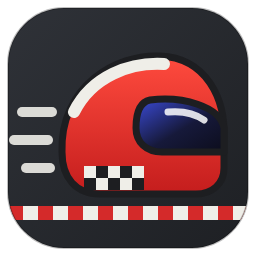
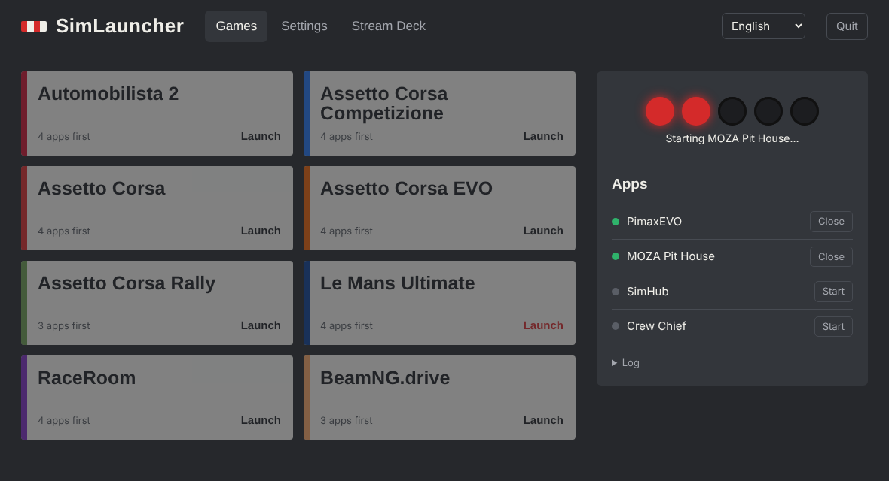

<p align="center"></p>

# SimLauncher

**One click (or one Stream Deck key) to start a whole sim racing session on Windows.**

A VR sim racing session usually means opening four or five programs in the right order before the game: the VR runtime, the wheel base software, SimHub, a spotter/engineer such as Crew Chief… SimLauncher starts each one if it isn't already running, waits for them to be ready, then launches the game through Steam.

[Français](README.fr.md)



## Features

- **Launch sequence per game**: choose which companion apps start before each game, in which order, with a delay after each.
- **Already running? Skipped.** Apps and games that are already open are not started twice.
- **Starting lights**: five lights follow the sequence and turn green when the game is launched.
- **Optional auto-close**: when the game exits, close the apps you marked (for example Crew Chief).
- **Your own game pictures**: pick any .jpg, .png or .webp image in Settings and it becomes the background of that game's card.
- **Built-in updates**: SimLauncher checks GitHub Releases for new versions and updates itself in one click, or automatically if you allow it (never during a session). Downloads are checked against the release's SHA-256.
- **Stream Deck ready**: every game has a command line to paste into a *System › Open* key. Key icons are included in `assets/streamdeck`.
- **Tray icon**: start with Windows as an icon next to the clock. Right-click to launch a game, double-click to open the interface.
- **MCP server**: let an AI assistant (Claude Desktop and others) list and launch your games.
- **5 languages**: English, Français, Português (Brasil), Español, 简体中文. Follows the Windows language by default.
- **Single portable .exe**, no installer, no runtime to install. Settings live in `%APPDATA%\SimLauncher\config.json`.

The default configuration targets a Pimax + MOZA + SimHub + Crew Chief rig with AMS2, ACC, Assetto Corsa, AC EVO, AC Rally, Le Mans Ultimate, RaceRoom and BeamNG.drive. Everything is editable in **Settings**: add any app or game (Steam AppID or any executable).

## Install

1. Download `SimLauncher.exe` from the [latest release](../../releases/latest).
2. Put it in a folder of your choice and double-click it.
3. Windows SmartScreen may warn about an unsigned app: *More info › Run anyway*.

## Use

| How | What happens |
|---|---|
| Double-click `SimLauncher.exe` | Opens the interface (an Edge app window). It stops when you close the window, unless it is running as a tray icon. |
| Settings › *Start with Windows* | Starts hidden at logon with a tray icon (`--tray`). |
| Stream Deck *System › Open* with `"C:\…\SimLauncher.exe" --game ams2` | Runs the sequence with no window. A message box appears only if something goes wrong. |

### Command line

```
SimLauncher.exe                 open the interface
SimLauncher.exe --game <id>     run the launch sequence for a game (Stream Deck, shortcuts)
SimLauncher.exe --game <id> --apps    only start the companion apps
SimLauncher.exe --game <id> --nowait  don't watch for the game exit
SimLauncher.exe --tray          tray icon, no window
SimLauncher.exe --mcp           MCP server on stdio
SimLauncher.exe --list          print game IDs
```

Game IDs are shown in the **Stream Deck** tab.

## MCP server (AI assistants)

SimLauncher speaks the [Model Context Protocol](https://modelcontextprotocol.io) over stdio. Tools: `list_games`, `launch_game`, `list_apps`, `start_app`, `stop_app`, `get_status`, `add_game`, `add_app`. For example, ask "add iRacing to SimLauncher" or "add OpenKneeboard before AMS2 and LMU". When SimLauncher is already running in the tray, the MCP server relays commands to it, so the interface and the auto-close watcher stay in sync.

Claude Desktop, `claude_desktop_config.json`:

```json
{
  "mcpServers": {
    "simlauncher": {
      "command": "C:\\Path\\To\\SimLauncher.exe",
      "args": ["--mcp"]
    }
  }
}
```

Then ask: *“Launch Le Mans Ultimate”* or *“Is SimHub running?”*

## Build from source

Requires Go 1.22+. Builds the Windows exe from any OS:

```sh
go install github.com/akavel/rsrc@v0.10.2   # optional, embeds the icon
./build.sh                                   # → dist/SimLauncher.exe
```

Tests run on any OS (Windows calls are replaced by a fake): `go test ./...`. Node.js is used, when present, to check that every UI language has every string.

Layout: `launcher.go` (sequence), `config.go`, `server.go` (local API + UI), `ui/index.html` (interface), `tray_windows.go`, `sys_windows.go` (Win32), `mcp.go`, `i18n.go` (engine strings).

## Translations

- Engine and tray messages: `i18n.go` (`catalog`).
- Interface: the `I18N` object at the top of the script in `ui/index.html`.

To add a language, add its code to `languages` in `i18n.go`, a column in `catalog`, a block in `I18N` and an `<option>` in the language menu. `go test` fails if a string or a placeholder is missing.

## Notes

- The interface is served on `127.0.0.1:47821` only (configurable). Requests that change something must carry an `X-SimLauncher` header, so other web pages can't trigger launches.
- Game process names are only used by the optional auto-close. If it doesn't trigger, check the exact name in Task Manager › Details.

## License

MIT. SimLauncher is not affiliated with Pimax, MOZA Racing, SimHub, Crew Chief, Elgato, Valve or any game publisher. Game names are trademarks of their owners; the bundled Stream Deck icons are original artwork.
